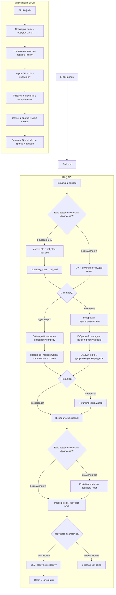

# ML System Design Doc – Интуиция

> ## Термины и пояснения
> - Итерация - все работы, которые совершаются до старта очередного пилота
> - БТ - бизнес-требования
> - MVP - минимально жизнеспособная версия функции, которую проверяем в пилоте
> - RAG - Retrieval-Augmented Generation; ответ формируется по найденным фрагментам книги, а не только по знаниям модели
> - CFI - Canonical Fragment Identifier; адрес места в EPUB, не зависящий от экрана и шрифта
> - char - порядковый номер символа в извлечённом тексте книги; используется для прогресса чтения и границ выделения
> - Антиспойлер - ограничение контекста для LLM прогрессом чтения и выделенным фрагментом текста
> - LLM - большая языковая модель, которая генерирует ответ по разрешённому контексту
> - Retrieval - поиск релевантных фрагментов книги в индексе
> - Гибридный поиск - комбинация dense (embedding) и sparse (ключевые слова) retrieval
> - `Product Owner`, `Data Scientist` - роли, которые заполняют соответствующие разделы

## 1. Цели и предпосылки

### 1.1. Зачем идем в разработку продукта? `Product Owner`

#### Бизнес-цель `Product Owner`

Продукт **Интуиция** позволяет задавать вопросы по книге во время чтения и получать ответы по её тексту, без раскрытия ещё не прочитанных событий.

#### Текущее состояние продукта `Product Owner`

В продукте уже работают:

- пользовательский интерфейс EPUB-ридера;
- бэкенд для работы с пользователями и книгами, включая сохранение прогресса чтения.

В текущей итерации эти компоненты не разрабатываются с нуля. Проект добавляет к существующему продукту новую функцию: вопросы по книге на основе RAG с антиспойлерным ограничением, использующим сохранённый прогресс чтения.

Продукт должен помочь читателю:

- уточнить смысл фрагмента, термина или события, не покидая книгу;
- вспомнить уже встречавшиеся факты и персонажей;
- получить краткое объяснение сложного места;
- избежать спойлеров из последующих частей книги.

#### Почему станет лучше, чем сейчас `Product Owner` & `Data Scientist`

Обычная языковая модель отвечает на основе знаний, полученных во время обучения, и не обязана опираться на текст конкретного издания. Поэтому она может смешать содержание книги с внешними сведениями, дать неточный ответ или ввести пользователя в заблуждение из-за галлюцинации. Кроме того, LLM может знать события из ещё не прочитанной части книги и раскрыть их в ответе.

RAG ограничивает ответ содержимым конкретной книги, а механизм антиспойлера дополнительно ограничивает доступный контекст текущим прогрессом чтения или границей выделенного текста. Это снижает риск галлюцинаций и позволяет формировать ответ, релевантный текущему месту чтения, без использования последующих частей книги.

#### Что считаем успехом текущей итерации с точки зрения бизнеса `Product Owner`

- пользователь может задать вопрос по добавленной книге;
- поддержаны вопросы с выделенным фрагментом и без выделения;
- пользователь получает ответ по разрешённой части книги вместе с источниками;
- пользовательская проверка не выявляет систематических спойлеров.

### 1.2. Бизнес-требования и ограничения `Product Owner`

#### Бизнес-требования `Product Owner`

1. Пользователь должен иметь возможность читать книгу и задавать вопросы по её содержанию.
2. Система должна поддерживать два режима:
   - **вопрос с выделением** – выделенный текст передаётся как явный контекст вопроса; retrieval не должен использовать текст после конца выделения;
   - **вопрос без выделения** – retrieval не должен использовать текст из глав, к которым пользователь ещё не приступил; уточнение границы внутри текущей главы – в следующих итерациях.
3. Ответ должен основываться на разрешённых фрагментах выбранной книги.
4. Если разрешённого контекста недостаточно, система должна сообщить об этом, а не дополнять ответ сведениями из непрочитанной части.
5. Для ответа нужно отображать использованные фрагменты книги, чтобы пользователь мог проверить источник.

#### Ограничения `Product Owner`

- В первой итерации основной формат книги – EPUB.
- Антиспойлер ограничивает контекст по сохранённому прогрессу и выделению пользователя; динамический номер страницы не используется.
- Качество ответа ограничено качеством извлечения текста, embedding-модели, retrieval и используемой LLM.
- В рамках MVP не гарантируется ответ на каждый вопрос: корректный отказ лучше ответа без достаточного разрешённого контекста.

#### Ожидания от текущей итерации `Product Owner`

- реализовать ingestion EPUB, чанкинг, dense- и sparse-индексацию и запись в Qdrant;
- реализовать и протестировать антиспойлерное ограничение по прогрессу и выделению пользователя;
- интегрировать RAG API с существующими ридером и бэкендом;
- сравнить четыре конфигурации RAG из раздела 2.1 («Сравниваемые конфигурации RAG») и выбрать вариант для MVP;
- подготовить тесты качества retrieval и генерации;
- собирать трейсы запросов в Langfuse и измерять `p50`/`p95` latency.

#### Бизнес-процесс пилота `Product Owner`

Пользователь открывает книгу в ридере, читает её и задаёт вопрос одним из двух способов:

1. выделяет фрагмент и формулирует вопрос о нём;
2. задаёт общий вопрос с текущей позиции чтения.

Система определяет допустимую границу, извлекает только разрешённые фрагменты, формирует ответ и показывает его вместе с источниками. После ответа пользователь оценивает его полезность и наличие спойлера.

#### Предварительные критерии успешного пилота `Product Owner`

- большинство вопросов, для которых в прочитанной части есть ответ, получают релевантный и подтверждённый источниками ответ;
- пользователи понимают ответ и не отмечают в нём раскрытие будущих событий.

#### Возможные пути развития после пилота `Product Owner`

Успешный пилот — выполнение метрик раздела 3.2, выбор конфигурации RAG и отсутствие систематических жалоб на спойлеры и неподтверждённые ответы. Продукт остаётся **EPUB-ридером с RAG**; дальнейшее развитие сводится к двум направлениям.

1. **Расширение оценки и анализ пользовательской обратной связи** `Product Owner` & `Data Scientist`

   Расширяем offline- и пилотные сценарии: вопрос с выделением и без, разные позиции прогресса, антиспойлерные кейсы, EPUB с разной структурой, регрессия на зафиксированном eval при смене моделей или чанкинга. В ридере после ответа собираем полезность, отметку спойлера или неподтверждённого утверждения и по возможности краткий комментарий; данные связываем с книгой, конфигурацией RAG, режимом запроса, идентификаторами чанков и результатом антиспойлера **без** полного текста книги и prompt в аналитике (как в разделе 3.3). Анализируем агрегаты и расхождения с метриками retrieval, Faithfulness, Anti-spoiler Rate и трассами Langfuse, разбираем ошибки по рубрике и переносим подтверждённые кейсы в регрессионный eval; по частоте замечаний задаём приоритет доработок.

2. **Поэтапное внедрение после успешного пилота** `Product Owner` & `Data Scientist`

   По результатам пункта 1 вводим изменения в продукт: **антиспойлер** (граница по char внутри главы, post-filter и автотесты, guardrails от косвенного спойлера, понятные отказы); **качество RAG на EPUB** (ingestion и CFI/char, чанкинг и hybrid retrieval, переход к источнику в ридере, пересмотр порогов раздела 3.2 при смене моделей); **опыт чтения** (подсказки про выделение, история вопросов по книге); **масштаб** (индексация при загрузке, лимиты и оптимизация cost/latency, controlled rollout, SLA, мониторинг и политики хранения данных). Порядок работ уточняется по обратной связи: спойлеры и недоверие — в первую очередь антиспойлер; слабые ответы при редких спойлерах — retrieval и генерация; стабильное качество при высокой задержке или cost — оптимизация и production-rollout.

### 1.3. Что входит в скоуп проекта/итерации, что не входит `Data Scientist`

#### Входит в скоуп `Data Scientist`

- обработка, чанкинг и индексация книг в формате EPUB;
- RAG для вопросов с выделенным фрагментом и без выделения;
- антиспойлерное ограничение по прогрессу чтения и выделению пользователя;
- сравнение четырёх конфигураций RAG из раздела 2.1 («Сравниваемые конфигурации RAG»);
- оценка качества retrieval, генерации и соблюдения антиспойлерного ограничения;
- трассировка RAG-пайплайна в Langfuse;
- воспроизводимый код, конфигурация Ruff и pre-commit.

#### Не входит в скоуп `Data Scientist`

- разработка EPUB-ридера и пользовательского интерфейса чтения с нуля;
- разработка базового бэкенда пользователей, книг и хранения прогресса чтения;
- поддержка PDF, FB2 и других форматов;
- синхронизация прогресса между сторонними приложениями для чтения;
- поиск по нескольким книгам одновременно;
- рекомендательная система книг;
- обучение собственной LLM или embedding-модели;
- production-инфраструктура, высокая доступность и масштабирование на большое число одновременных пользователей;
- полноценная система авторизации, оплаты и управления библиотекой;
- гарантированное устранение спойлеров, содержащихся в самом вопросе пользователя.

#### Качество кода и воспроизводимость `Data Scientist`

- параметры ingestion и RAG должны задаваться конфигурацией;
- эксперимент должен фиксировать выбранные параметры и используемые модели;
- статический анализ и форматирование выполняются Ruff;
- проверки запускаются через pre-commit;
- ключевая логика RAG и антиспойлера покрывается автоматическими тестами.

#### Планируемый технический долг `Data Scientist`

- первоначальная оценка качества выполняется на вопросах из LibRA; пользовательские фрагменты размечаются с помощью LLM и проверяются вручную;
- более точное ограничение внутри текущей главы для вопросов без выделения откладывается на следующую итерацию;
- production-мониторинг с алертами не входит в MVP; в пилоте используются трейсы Langfuse;
- набор поддерживаемых EPUB может быть ограничен книгами без сложной вёрстки, DRM и нестандартного порядка текста;
- защита от косвенного спойлера, который LLM восстановила из общих знаний, может потребовать дополнительных guardrails.

### 1.4. Предпосылки решения `Data Scientist`

Существующие ридер и бэкенд хранят прогресс пользователя по каждой книге. Для RAG используются текущая глава и CFI-позиция пользователя.

На бэкенде CFI преобразуется в char-координаты; границы выделения задаются `char_start` и `char_end`. Антиспойлер ограничивает поиск текущей главой и границей выделения, чтобы текст из непрочитанной части книги не передавался в LLM. Для каждой книги используется отдельная коллекция Qdrant.

## 2. Методология `Data Scientist`

### 2.1. Постановка задачи `Data Scientist`

С технической точки зрения разрабатывается RAG-система вопрос-ответ по книге, которая учитывает сохранённый прогресс чтения пользователя.

Задача состоит из следующих частей:

1. извлечь текст EPUB, разбить его на чанки и проиндексировать в Qdrant (dense и sparse);
2. найти релевантные фрагменты с учётом прогресса чтения и выделения;
3. сформировать ответ по найденному контексту и вернуть источники либо корректный отказ;
4. сравнить конфигурации RAG по качеству, скорости и стоимости.

#### Бейзлайн `Data Scientist`

- фиксированный размер чанка и overlap;
- vanilla гибридный retrieval: dense- и sparse-компоненты по исходному вопросу;
- `top-k` релевантных фрагментов из коллекции книги;
- генерация ответа по найденному контексту.

#### Сравниваемые конфигурации RAG `Data Scientist`

1. **Vanilla RAG без реранкинга.** Для исходного вопроса выполняется гибридный поиск в Qdrant, после чего выбираются `top-k` наиболее релевантных разрешённых чанков; ответ генерирует `llm_answer` (см. «Выбор моделей»).
2. **Vanilla RAG с реранкингом.** Сначала гибридный retrieval извлекает расширенный набор кандидатов, затем `reranker` повторно оценивает пары «вопрос – чанк» и выбирает итоговые `top-k` чанков; ответ генерирует `llm_answer` (модели — см. «Выбор моделей»).
3. **Multi-query RAG без реранкинга.** Модель `llm_rewrite` (см. «Выбор моделей») формирует несколько переформулировок исходного вопроса. Для каждой формулировки выполняется гибридный retrieval, результаты объединяются, дублирующиеся чанки удаляются, после чего выбираются итоговые `top-k` кандидатов; ответ генерирует `llm_answer`.
4. **Multi-query RAG с реранкингом.** Кандидаты, полученные гибридным retrieval по исходному вопросу и переформулировкам от `llm_rewrite`, объединяются и передаются `reranker`, который выбирает итоговые `top-k` чанков; ответ генерирует `llm_answer` (модели — см. «Выбор моделей»).

Бейзлайном для экспериментов считается **конфигурация 1** (vanilla RAG без reranker на гибридном поиске). Конфигурации 2–4 сравниваются с ней; для пилота выбирается один из четырёх вариантов по метрикам раздела 3.2.

Для корректного сравнения на первом эксперименте фиксируются embedding-модель, схема гибридного поиска (dense и sparse), параметры чанкинга, антиспойлерный фильтр и итоговое количество чанков, передаваемых в LLM (см. подраздел «Выбор моделей (embedding, reranker, LLM)» ниже). Конфигурации RAG 1–4 сравниваются на одном наборе вопросов по качеству retrieval и ответа, задержке и стоимости. Настройка размера чанка, overlap и `top-k` выполняется отдельно, чтобы не смешивать влияние нескольких факторов.

Сравнение конфигураций RAG 1–4 (см. подраздел «Сравниваемые конфигурации RAG» выше) выполняется при **одних и тех же** выбранных моделях (`embedding`, `reranker` для конфигураций 2 и 4, `llm_answer`; см. «Выбор моделей»), чтобы изолировать эффект multi-query и reranking, а не смены foundation-моделей.

#### Выбор моделей (embedding, reranker, LLM) `Data Scientist`

Ключи `embedding`, `reranker`, `llm_answer`, `llm_rewrite` задают, какие сервисы используются в **конфигурациях RAG 1–4** (см. подраздел «Сравниваемые конфигурации RAG» выше). Собственные модели не обучаются; используются готовые embedding-, reranker- и LLM-сервисы по API. Книги и вопросы в пилоте — **на русском языке**, поэтому кандидаты должны уверенно работать с русским художественным и нон-фикшн текстом.

**Ограничения:** бюджет и квоты провайдера, допустимая задержка end-to-end, совместимость с Qdrant (размерность вектора embedding), требование фиксировать версии моделей в конфигурации эксперимента и в трассах Langfuse.

**Порядок выбора:**

1. **Embedding-модель** (`embedding`) — для **всех конфигураций RAG 1–4** (см. «Сравниваемые конфигурации RAG»); на коротком списке кандидатов (2–3 модели с поддержкой русского / multilingual retrieval) на одном eval-наборе (LibRA + антиспойлерные кейсы) и одной книге измеряются `Recall@10`, `MRR@10`, время индексации и стоимость embedding всей книги. Победитель фиксируется для всех дальнейших экспериментов. Sparse-компонент hybrid (ключевые слова) остаётся общим для всех кандидатов dense.
2. **Reranker** (`reranker`) — оценивается для **конфигураций RAG 2 и 4** (см. «Сравниваемые конфигурации RAG»): при том же `embedding` сравниваются 1–2 cross-encoder (или аналог) на русскоязычных парах «вопрос – чанк»; учитываются прирост retrieval-метрик относительно конфигурации 1, latency rerank на расширенном пуле кандидатов и стоимость вызова.
3. **LLM для ответа** (`llm_answer`) — основная модель генерации для **всех конфигураций RAG 1–4** (см. «Сравниваемые конфигурации RAG»): приоритет `Faithfulness`, `Answer Correctness`, качество формулировок на русском, устойчивость к инструкции «только по контексту»; учитываются лимит контекста под выбранный `top-k`, `p95` latency и цена за запрос.
4. **LLM для multi-query** (`llm_rewrite`) — отдельная, **более лёгкая и дешёвая** модель только для переформулировок в **конфигурациях RAG 3 и 4** (см. «Сравниваемые конфигурации RAG»). Требования ниже, чем к `llm_answer`: корректный русский, разнообразие формулировок без галлюцинаций фактов из книги; минимизация токенов и задержки. `llm_answer` при этом не меняется.

**Результат этапа:** в конфигурации проекта фиксируются идентификаторы моделей из пунктов 1–4 этого подраздела (`embedding`, `reranker`, `llm_answer`, `llm_rewrite`), их версии и лимиты (число переформулировок, размер candidate pool). Конкретные названия моделей определяются после прогона кандидатов по критериям выше и ограничениям стоимости; до фиксации в конфиге допускается короткий A/B на LibRA без смены антиспойлера, чанкинга и **конфигурации RAG** (см. «Сравниваемые конфигурации RAG»).

### 2.2. Блок-схема решения `Data Scientist`

Схема отражает **двухэтапный антиспойлер**: фильтр по главе в Qdrant и post-filter по `boundary_char` после retrieval (при выделении); resolve CFI на бэкенде по той же карте, что при индексации.

### 2.3. Этапы решения задачи `Data Scientist`

#### Этап 1. Подготовка данных `Data Scientist`

Обучение собственной модели не планируется. Для индексации и оценки RAG используются следующие данные:

| Название данных | Есть ли данные и источник | Требуемый ресурс для получения данных | Проверено ли качество |
|---|---|---|---|
| Книги в формате EPUB | Да, существующее хранилище книг | Backend-разработчик, Data Scientist | Да, качество проверено, замечаний нет |
| Прогресс чтения и CFI-позиции | Да, существующий бэкенд | Frontend-разработчик, Backend-разработчик, Data Scientist | Да, качество проверено, замечаний нет |
| Вопросы по книгам | Да, LibRA | Data Scientist | Да, качество проверено, замечаний нет |
| Выделенные фрагменты и эталонные фрагменты к вопросам | Частично, дополняются к вопросам из LibRA | Data Scientist, разметка с помощью LLM и проверка вручную | Да, качество проверено, замечаний нет |

Вопросы для оценки retrieval и генерации берутся из LibRA. К этим вопросам нужно добавить **фрагменты от пользователя** (выделенный текст, позиции прогресса и эталонные фрагменты с ответом) для сценариев с выделением, без выделения и для антиспойлерных тестов. Разметка выполняется **с помощью LLM**, затем **проверяется вручную**.

- извлечь текст EPUB, разбить его на чанки и проиндексировать в Qdrant (dense и sparse);
- проверить корректность индексации на книгах с разной структурой.

#### Этап 2. Бейзлайн RAG `Data Scientist`

- реализовать vanilla гибридный retrieval и генерацию ответа;
- подготовить контрольный набор вопросов и измерить качество бейзлайна.

#### Этап 3. Механизм антиспойлера `Data Scientist`

- ограничить контекст прогрессом чтения и выделением пользователя;
- проверить механизм на контрольном наборе.

#### Этап 4. Эксперименты с RAG `Data Scientist`

- сравнить четыре конфигурации из раздела 2.1 на одном наборе вопросов;
- выбрать вариант для MVP по качеству, задержке и стоимости.

#### Этап 5. Подготовка пилота `Data Scientist`

- интегрировать RAG API с существующими интерфейсом чтения и бэкендом;
- добавить отображение источников и сбор пользовательской оценки.

## 3. Подготовка пилота

### 3.1. Способ оценки пилота `Product Owner` & `Data Scientist`

Пилот проводится на подготовленном наборе **русскоязычных** EPUB, пользовательских вопросов и зафиксированных позиций чтения. Для части вопросов дополнительно задаются выделенный фрагмент и эталонные фрагменты, содержащие ответ.

В пилоте используется конфигурация RAG, выбранная по результатам этапа 4.

Для выбранной конфигурации измеряются retrieval-метрики, качество ответа, время отклика (`p50` и `p95` latency) и примерная стоимость запроса. Антиспойлерное ограничение проверяется отдельно и не участвует в компромиссе между качеством и скоростью.

После автоматической оценки проводится пользовательская проверка. Пользователь читает книгу, задаёт вопросы с выделением и без него, оценивает полезность ответа и отмечает возможный спойлер или утверждение, не подтверждённое книгой.

### 3.2. Что считаем успешным пилотом? Критерии успеха `Product Owner`

- `Recall@10 ≥ 0.80` – найдено не менее 80% релевантных фрагментов;
- `Hit@10 ≥ 0.90` – хотя бы один релевантный фрагмент найден для 90% вопросов;
- `MRR@10 ≥ 0.75` – первый релевантный фрагмент в среднем в верхней части top-10 (ориентир ~1–2 место);
- `Faithfulness ≥ 0.95` – утверждения ответа подтверждаются контекстом;
- `Answer Correctness ≥ 0.90` – ответ соответствует эталонному ответу;
- `Anti-spoiler Rate < 5%` – доля запросов, в которых в контекст LLM попал текст после разрешённой границы;
- система возвращает источники, которыми подтверждается ответ;
- пользовательская проверка не выявляет систематических спойлеров и неподтверждённых ответов.

### 3.3. Подготовка пилота `Data Scientist`

До запуска пилота необходимо:

- выбрать набор EPUB с разной структурой и подготовить проверку антиспойлера;
- собрать набор на базе LibRA и дополнить его пользовательскими фрагментами и эталонными фрагментами (разметка LLM, проверка вручную);
- зафиксировать позиции прогресса и выделения для антиспойлерных тестов;
- подготовить контур оценки выбранной конфигурации RAG;
- оценить число обращений к embedding-модели, reranker и LLM;
- установить ограничения на число multi-query-переформулировок, число retrieval-кандидатов и итоговый `top-k`;
- добавить трейсы Langfuse: один trace на пользовательский запрос и spans для multi-query, гибридного retrieval (dense и sparse), reranking, post-filter и LLM;
- не сохранять в Langfuse по умолчанию полный текст книги и фрагменты prompt; достаточно идентификаторов чанков, метаданных и агрегированных метрик;
- сохранять в trace конфигурацию RAG, времена этапов, токены и стоимость, идентификаторы найденных чанков, scores и результат антиспойлерного фильтра;
- добавить сбор использованных источников и пользовательской оценки.

Ожидаемые вычислительные затраты уточняются на экспериментах. Multi-query увеличивает число retrieval-запросов и требует вызова LLM для генерации переформулировок, а reranking добавляет отдельную обработку набора кандидатов. Поэтому финальная конфигурация выбирается не только по качеству, но и по задержке и стоимости.

#### Открытые вопросы и риски перед пилотом `Data Scientist`

- Как версионировать и тестировать карту соответствия CFI и char (UTF-16 vs code points)?
- Уложится ли набор моделей (`embedding`, `reranker`, `llm_answer`, `llm_rewrite`; см. «Выбор моделей», раздел 2.1) в лимиты стоимости провайдера при полном прогоне eval и пилота?
- Как оценивать непрямой спойлер, который модель знает из предобучения, даже если запрещённый текст не передан в prompt?
- Оправдают ли multi-query и reranking прирост качества увеличением задержки и стоимости?
