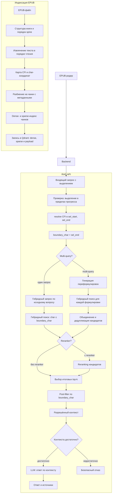

# ML System Design Doc – Интуиция

> ## Термины и пояснения
> - Итерация - все работы, которые совершаются до старта очередного пилота
> - БТ - бизнес-требования
> - MVP - минимально жизнеспособная версия функции, которую проверяем в пилоте
> - RAG - Retrieval-Augmented Generation; ответ формируется по найденным фрагментам книги, а не только по знаниям модели
> - CFI - Canonical Fragment Identifier; адрес места в EPUB, не зависящий от экрана и шрифта
> - char - порядковый номер символа в извлечённом тексте книги; используется для прогресса чтения и границ выделения
> - Антиспойлер - ограничение контекста для LLM **границей выделенного фрагмента** (char до конца выделения); прогресс чтения проверяет, что выделение не выходит за прочитанное
> - LLM - большая языковая модель, которая генерирует ответ по разрешённому контексту
> - LLM-судья (`llm_judge`) - отдельная модель, которая по rubric оценивает сгенерированный ответ offline; не совпадает с `llm_answer`, чтобы не оценивать «саму себя»
> - Retrieval - поиск релевантных фрагментов книги в индексе
> - TTFT (Time To First Token) - время от принятия запроса до **первого токена** стримингового ответа пользователю
> - Latency E2E - время от запроса до **полного** ответа (конец стрима / финальный chunk)
> - Cost per answer - **средняя стоимость одного ответа RAG** по пользовательскому пайплайну (один вопрос — один ответ через RAG API); без `llm_judge` и без индексации книги
> - Гибридный поиск - комбинация dense (embedding) и sparse (ключевые слова) retrieval
> - `Product Owner`, `Data Scientist` - роли, которые заполняют соответствующие разделы

## 1. Цели и предпосылки

### 1.1. Зачем идем в разработку продукта? `Product Owner`

#### Бизнес-цель `Product Owner`

Продукт **Интуиция** позволяет задавать вопросы по книге во время чтения и получать ответы по её тексту, без раскрытия ещё не прочитанных событий.

#### Подписка и экономика `Product Owner`

**Интуиция** — **подписочный** сервис: **300 ₽/мес** за доступ к ридеру и функциям чтения. В текущей итерации к подписке добавляется **RAG по книге** — одна из главных причин платить; ответы должны быть полезными и **не разрушать unit economics**.

При целевой **марже ~50%** на издержки остаётся около **150 ₽/мес** (инфра, платёжка, API и пр.), не на прибыль. Для RAG закладываем **средний cost одного ответа ~3 ₽** (раздел 3.2): при такой себестоимости активный читатель может задавать **порядка 30–50** вопросов в месяц в рамках экономики подписки. Выбор моделей и конфигурации RAG (раздел 2.1) и пороги пилота (раздел 3.2) согласуются с этими ориентирами.

#### Текущее состояние продукта `Product Owner`

В продукте уже работают:

- пользовательский интерфейс EPUB-ридера;
- бэкенд для работы с пользователями и книгами, включая сохранение прогресса чтения.

В текущей итерации эти компоненты не разрабатываются с нуля. Проект добавляет к существующему продукту новую функцию: **вопрос по выделенному фрагменту** на основе RAG с антиспойлером по **концу выделения** (прогресс чтения не даёт выделить непрочитанный текст).

Продукт должен помочь читателю:

- уточнить смысл фрагмента, термина или события, не покидая книгу;
- вспомнить уже встречавшиеся факты и персонажей;
- получить краткое объяснение сложного места;
- избежать спойлеров из последующих частей книги.

#### Почему станет лучше, чем сейчас `Product Owner` & `Data Scientist`

Обычная языковая модель отвечает на основе знаний, полученных во время обучения, и не опирается на текст конкретного издания. Поэтому она может смешать содержание книги с внешними сведениями, дать неточный ответ или ввести пользователя в заблуждение из-за галлюцинации. Кроме того, LLM может знать события из ещё не прочитанной части книги и раскрыть их в ответе.

Другая привязка к книге — передать в LLM **весь текст разрешённой части** (прочитанное по прогрессу или до конца выделения). У LLM **конечный контекст**: по мере чтения объём приближается к лимиту, а при **полном или почти полном** заполнении окна **сильно снижается качество** ответа — модель хуже опирается на нужные места в длинном тексте. Если прочитанное **не помещается целиком**, текст **обрезают** — появляются **краевые случаи**: хвост прочитанного или **конец произведения не входит** в контекст, а вопрос как раз про эти события; итог зависит от того, «влезла» ли текущая граница прогресса в контекст.

**RAG** на каждый вопрос подбирает **небольшой релевантный** набор фрагментов из индекса книги вместо переноса всей прочитанной части в prompt. Антиспойлер ограничивает retrieval и контекст LLM **char-границей выделения** (и проверкой прогресса). Так ответ меньше деградирует на длинных книгах и реже упирается в обрезку, когда важный фрагмент оказался за пределами контекста; вместе с привязкой к тексту книги это снижает риск галлюцинаций относительно «голой» LLM.

#### Что считаем успехом текущей итерации с точки зрения бизнеса `Product Owner`

- пользователь может задать вопрос по добавленной книге;
- поддержаны **только** вопросы **с выделенным фрагментом** (без выделения — вне MVP);
- пользователь получает ответ по разрешённой части книги вместе с источниками;
- пользовательская проверка не выявляет систематических спойлеров.

### 1.2. Бизнес-требования и ограничения `Product Owner`

#### Бизнес-требования `Product Owner`

1. Пользователь должен иметь возможность читать книгу и задавать вопросы по её содержанию.
2. Система должна поддерживать **вопрос с выделением**: пользователь **обязан** выделить фрагмент в ридере; выделенный текст передаётся как явный контекст вопроса; retrieval и ответ **не используют текст после конца выделения** (`boundary_char = sel_end`). Конец выделения не должен быть **дальше** сохранённого прогресса чтения.
3. Ответ должен основываться на разрешённых фрагментах выбранной книги.
4. Если разрешённого контекста недостаточно, система должна сообщить об этом, а не дополнять ответ сведениями из непрочитанной части.
5. Для ответа нужно отображать использованные фрагменты книги, чтобы пользователь мог проверить источник.

#### Ограничения `Product Owner`

- В первой итерации основной формат книги – EPUB.
- Антиспойлер в MVP опирается на **границу выделения**; прогресс чтения используется для **валидации** выделения; динамический номер страницы не используется.
- Качество ответа ограничено качеством извлечения текста, embedding-модели, retrieval и используемой LLM.
- В рамках MVP не гарантируется ответ на каждый вопрос: корректный отказ лучше ответа без достаточного разрешённого контекста.
- Экономика подписки и cost ответа RAG — раздел 1.1 («Подписка и экономика»); числовые пороги пилота — раздел 3.2.

#### Ожидания от текущей итерации `Product Owner`

- реализовать ingestion EPUB, чанкинг, dense- и sparse-индексацию и запись в Qdrant;
- реализовать и протестировать антиспойлер по **концу выделения** (и проверку прогресса);
- интегрировать RAG API с существующими ридером и бэкендом;
- сравнить четыре конфигурации RAG из раздела 2.1 («Сравниваемые конфигурации RAG») и выбрать вариант для MVP;
- подготовить тесты качества retrieval и генерации;
- собирать трейсы запросов в Langfuse, **логировать `TTFT` и latency E2E** (`ttft_ms`, `e2e_ms`) на каждый ответ RAG и агрегировать `p50`/`p95` по этим полям.

#### Бизнес-процесс пилота `Product Owner`

Пользователь открывает книгу в ридере, читает её, **выделяет фрагмент** и формулирует вопрос о нём.

Система строит **границу антиспойлера** по концу выделения, извлекает только разрешённые фрагменты, формирует ответ и показывает его вместе с источниками. После ответа пользователь оценивает его полезность и наличие спойлера.

#### Возможные пути развития после пилота `Product Owner`

Успешный пилот — выполнение метрик раздела 3.2, выбор конфигурации RAG и отсутствие систематических жалоб на спойлеры и неподтверждённые ответы. Продукт остаётся **EPUB-ридером с RAG**; дальнейшее развитие сводится к двум направлениям.

1. **Расширение оценки и анализ пользовательской обратной связи** `Product Owner` & `Data Scientist`

   Расширяем offline- и пилотные сценарии: вопрос **с выделением**, разные позиции выделения и прогресса, антиспойлерные кейсы, EPUB с разной структурой, регрессия на зафиксированном eval при смене моделей или чанкинга. В ридере после ответа собираем полезность, отметку спойлера или неподтверждённого утверждения и по возможности краткий комментарий; данные связываем с книгой, конфигурацией RAG, идентификаторами чанков и результатом антиспойлера **без** полного текста книги и prompt в аналитике (как в разделе 3.3). Анализируем агрегаты и расхождения с метриками retrieval, Faithfulness, Anti-spoiler Rate и трассами Langfuse, разбираем ошибки по рубрике и переносим подтверждённые кейсы в регрессионный eval; по частоте замечаний задаём приоритет доработок.

2. **Поэтапное внедрение после успешного пилота** `Product Owner` & `Data Scientist`

   По результатам пункта 1 вводим изменения в продукт: **антиспойлер** (post-filter по `boundary_char`, автотесты, guardrails от косвенного спойлера, понятные отказы; опционально **вопрос без выделения** с границей по прогрессу — отдельная итерация); **качество RAG на EPUB** (ingestion и CFI/char, чанкинг и hybrid retrieval, переход к источнику в ридере, пересмотр порогов раздела 3.2 при смене моделей); **опыт чтения** (подсказки про выделение, история вопросов по книге); **масштаб** (индексация при загрузке, лимиты и оптимизация cost/latency, controlled rollout, SLA, мониторинг и политики хранения данных). Порядок работ уточняется по обратной связи: спойлеры и недоверие — в первую очередь антиспойлер; слабые ответы при редких спойлерах — retrieval и генерация; стабильное качество при высокой задержке или cost — оптимизация и production-rollout.

### 1.3. Что входит в скоуп проекта/итерации, что не входит `Data Scientist`

#### Входит в скоуп `Data Scientist`

- обработка, чанкинг и индексация книг в формате EPUB;
- RAG **только** для вопросов **с выделенным фрагментом**;
- антиспойлерное ограничение по **концу выделения** (с проверкой прогресса чтения);
- сравнение четырёх конфигураций RAG из раздела 2.1 («Сравниваемые конфигурации RAG»);
- оценка качества retrieval, генерации и соблюдения антиспойлерного ограничения;
- трассировка RAG-пайплайна в Langfuse;
- воспроизводимый код, конфигурация Ruff и pre-commit.

#### Не входит в скоуп `Data Scientist`

- разработка EPUB-ридера и пользовательского интерфейса чтения с нуля;
- разработка базового бэкенда пользователей, книг и хранения прогресса чтения;
- поддержка PDF, FB2 и других форматов;
- синхронизация прогресса между сторонними приложениями для чтения;
- **общий вопрос без выделения** («с текущей позиции чтения») — следующие итерации;
- поиск по нескольким книгам одновременно;
- рекомендательная система книг;
- обучение собственной LLM или embedding-модели;
- production-инфраструктура, высокая доступность и масштабирование на большое число одновременных пользователей;
- полноценная система авторизации, оплаты и управления библиотекой;
- гарантированное устранение спойлеров, содержащихся в самом вопросе пользователя.

#### Качество кода и воспроизводимость `Data Scientist`

- параметры ingestion и RAG должны задаваться конфигурацией;
- эксперимент должен фиксировать выбранные параметры и используемые модели;
- статический анализ и форматирование выполняются Ruff;
- проверки запускаются через pre-commit;
- ключевая логика RAG и антиспойлера покрывается автоматическими тестами.

#### Планируемый технический долг `Data Scientist`

- первоначальная оценка качества выполняется на вопросах из LibRA; пользовательские фрагменты размечаются с помощью LLM и проверяются вручную;
- режим **вопроса без выделения** (граница по прогрессу внутри главы) откладывается на следующую итерацию;
- production-мониторинг с алертами не входит в MVP; в пилоте используются трейсы Langfuse;
- набор поддерживаемых EPUB может быть ограничен книгами без сложной вёрстки, DRM и нестандартного порядка текста;
- защита от косвенного спойлера, который LLM восстановила из общих знаний, может потребовать дополнительных guardrails.

### 1.4. Предпосылки решения `Data Scientist`

Существующие ридер и бэкенд хранят прогресс пользователя по каждой книге. Запрос RAG **возможен только при выделении** фрагмента в ридере (CFI / char).

На бэкенде CFI преобразуется в char-координаты; границы выделения — `char_start` и `char_end`; **`boundary_char = char_end`**. Retrieval и post-filter **не используют чанки с текстом после `boundary_char`**; до вызова RAG проверяется, что выделение **не выходит за** сохранённый прогресс чтения. Для каждой книги — отдельная коллекция Qdrant.

## 2. Методология `Data Scientist`

### 2.1. Постановка задачи `Data Scientist`

С технической точки зрения разрабатывается RAG-система вопрос-ответ по **выделенному фрагменту** книги с антиспойлером по концу выделения (прогресс — для валидации выделения).

Задача состоит из следующих частей:

1. извлечь текст EPUB, разбить его на чанки и проиндексировать в Qdrant (dense и sparse);
2. найти релевантные фрагменты с учётом **границы выделения** (и прогресса чтения);
3. сформировать ответ по найденному контексту и вернуть источники либо корректный отказ;
4. сравнить конфигурации RAG по качеству, скорости и стоимости.

#### Бейзлайн `Data Scientist`

- фиксированный размер чанка и overlap;
- vanilla гибридный retrieval: dense- и sparse-компоненты по исходному вопросу;
- `top-k` релевантных фрагментов из коллекции книги;
- генерация ответа по найденному контексту.

#### Сравниваемые конфигурации RAG `Data Scientist`

1. **Vanilla RAG без реранкинга.** Для исходного вопроса выполняется гибридный поиск в Qdrant, после чего выбираются `top-k` наиболее релевантных разрешённых чанков; ответ генерирует `llm_answer` (см. «Выбор моделей»).
2. **Vanilla RAG с реранкингом.** Сначала гибридный retrieval извлекает расширенный набор кандидатов, затем `reranker` повторно оценивает пары «вопрос – чанк» и выбирает итоговые `top-k` чанков; ответ генерирует `llm_answer` (модели — см. «Выбор моделей»).
3. **Multi-query RAG без реранкинга.** Модель `llm_rewrite` (см. «Выбор моделей») формирует несколько переформулировок исходного вопроса. Для каждой формулировки выполняется гибридный retrieval, результаты объединяются, дублирующиеся чанки удаляются, после чего выбираются итоговые `top-k` кандидатов; ответ генерирует `llm_answer`.
4. **Multi-query RAG с реранкингом.** Кандидаты, полученные гибридным retrieval по исходному вопросу и переформулировкам от `llm_rewrite`, объединяются и передаются `reranker`, который выбирает итоговые `top-k` чанков; ответ генерирует `llm_answer` (модели — см. «Выбор моделей»).

Бейзлайном для экспериментов считается **конфигурация 1** (vanilla RAG без reranker на гибридном поиске). Конфигурации 2–4 сравниваются с ней; для пилота выбирается один из четырёх вариантов по метрикам раздела 3.2.

Для корректного сравнения на первом эксперименте фиксируются embedding-модель, схема гибридного поиска (dense и sparse), параметры чанкинга, антиспойлерный фильтр и итоговое количество чанков, передаваемых в LLM (см. подраздел «Выбор моделей (embedding, reranker, LLM)» ниже). Конфигурации RAG 1–4 сравниваются на одном наборе вопросов по качеству retrieval и ответа, задержке и стоимости. Настройка размера чанка, overlap и `top-k` выполняется отдельно, чтобы не смешивать влияние нескольких факторов.

Сравнение конфигураций RAG 1–4 (см. подраздел «Сравниваемые конфигурации RAG» выше) выполняется при **одних и тех же** выбранных моделях (`embedding`, `reranker` для конфигураций 2 и 4, `llm_answer`; см. «Выбор моделей»), чтобы изолировать эффект multi-query и reranking, а не смены foundation-моделей.

#### Выбор моделей (embedding, reranker, LLM) `Data Scientist`

Ключи `embedding`, `reranker`, `llm_answer`, `llm_rewrite` задают, какие сервисы используются в **конфигурациях RAG 1–4** (см. подраздел «Сравниваемые конфигурации RAG» выше). Собственные модели не обучаются; используются готовые embedding-, reranker- и LLM-сервисы по API. Книги и вопросы в пилоте — **на русском языке**, поэтому кандидаты должны уверенно работать с русским художественным и нон-фикшн текстом.

**Ограничения:** бюджет и квоты провайдера, допустимая задержка end-to-end, совместимость с Qdrant (размерность вектора embedding), требование фиксировать версии моделей в конфигурации эксперимента и в трассах Langfuse.

**Порядок выбора:**

1. **Embedding-модель** (`embedding`) — для **всех конфигураций RAG 1–4** (см. «Сравниваемые конфигурации RAG»); на коротком списке кандидатов (2–3 модели с поддержкой русского / multilingual retrieval) на одном eval-наборе (LibRA + антиспойлерные кейсы) и одной книге измеряются `Recall@10`, `MRR@10`, время индексации и стоимость embedding всей книги. Победитель фиксируется для всех дальнейших экспериментов. Sparse-компонент hybrid (ключевые слова) остаётся общим для всех кандидатов dense.
2. **Reranker** (`reranker`) — оценивается для **конфигураций RAG 2 и 4** (см. «Сравниваемые конфигурации RAG»): при том же `embedding` сравниваются 1–2 cross-encoder (или аналог) на русскоязычных парах «вопрос – чанк»; учитываются прирост retrieval-метрик относительно конфигурации 1, latency rerank на расширенном пуле кандидатов и стоимость вызова.
3. **LLM для ответа** (`llm_answer`) — основная модель генерации для **всех конфигураций RAG 1–4** (см. «Сравниваемые конфигурации RAG»). На одном eval-наборе (LibRA + антиспойлерные кейсы), при **одинаковых** retrieval, prompt и `top-k` **сравниваются два кандидата**: **DeepSeek V4.1 Flash** и **Qwen3.8-27B**. Критерии выбора: `Faithfulness`, `Answer Correctness` (через `llm_judge`, раздел 3.2), качество формулировок на русском, устойчивость к инструкции «только по контексту», лимит контекста, `p95` latency E2E, **`Cost per answer`** (раздел 3.2). **После сравнения** выбранная модель фиксируется как `llm_answer` для всех дальнейших экспериментов (конфигурации RAG 1–4 и пилот); идентификатор в API провайдера записывается в конфиг и Langfuse.
4. **LLM для multi-query** (`llm_rewrite`) — отдельная, **более лёгкая и дешёвая** модель только для переформулировок в **конфигурациях RAG 3 и 4** (см. «Сравниваемые конфигурации RAG»). Требования ниже, чем к `llm_answer`: корректный русский, разнообразие формулировок без галлюцинаций фактов из книги; минимизация токенов и задержки. `llm_answer` при этом не меняется.
5. **LLM-судья** (`llm_judge`) — для offline-метрик **`Faithfulness`** и **`Answer Correctness`** (раздел 3.2) используется **`GPT-4o`**. Модель **не совпадает** с `llm_answer` и **не участвует** в RAG-пайплайне пилота. Версия `GPT-4o` (snapshot API) фиксируется в конфиге eval и не меняется при сравнении конфигураций RAG 1–4.

**Результат этапа:** в конфигурации проекта фиксируются идентификаторы моделей из пунктов 1–5 этого подраздела (`embedding`, `reranker`, `llm_answer`, `llm_rewrite`, `llm_judge`), их версии и лимиты (число переформулировок, размер candidate pool). Для `llm_answer` после сравнения **DeepSeek V4.1 Flash** vs **Qwen3.8-27B** остаётся **одна** выбранная модель; сравнение конфигураций RAG 1–4 выполняется уже на ней. Для `embedding` и `reranker` названия определяются отдельными прогонами кандидатов; до фиксации `llm_answer` допускается сравнение двух LLM на LibRA без смены антиспойлера, чанкинга и **конфигурации RAG** (см. «Сравниваемые конфигурации RAG»).

### 2.2. Блок-схема решения `Data Scientist`

Схема отражает **антиспойлер по выделению**: фильтр retrieval и post-filter по **`boundary_char = sel_end`**; resolve CFI на бэкенде по той же карте, что при индексации; запрос **без выделения** в MVP не принимается.

### 2.3. Этапы решения задачи `Data Scientist`

#### Этап 1. Подготовка данных `Data Scientist`

Обучение собственной модели не планируется. Для индексации и оценки RAG используются следующие данные:

| Название данных | Есть ли данные и источник | Требуемый ресурс для получения данных | Проверено ли качество |
|---|---|---|---|
| Книги в формате EPUB | Да, существующее хранилище книг | Backend-разработчик, Data Scientist | Да, качество проверено, замечаний нет |
| Прогресс чтения и CFI-позиции | Да, существующий бэкенд | Frontend-разработчик, Backend-разработчик, Data Scientist | Да, качество проверено, замечаний нет |
| Вопросы по книгам | Да, LibRA | Data Scientist | Да, качество проверено, замечаний нет |
| Выделенные фрагменты и эталонные фрагменты к вопросам | Частично, дополняются к вопросам из LibRA | Data Scientist, разметка с помощью LLM и проверка вручную | Да, качество проверено, замечаний нет |

Вопросы для оценки retrieval и генерации берутся из LibRA. К каждому вопросу задаётся **обязательное выделение** (выделенный текст, `sel_start` / `sel_end`, прогресс чтения) и **эталонные фрагменты** с ответом; отдельно — антиспойлерные кейсы. Разметка выполняется **с помощью LLM**, затем **проверяется вручную**.

- извлечь текст EPUB, разбить его на чанки и проиндексировать в Qdrant (dense и sparse);
- проверить корректность индексации на книгах с разной структурой.

#### Этап 2. Бейзлайн RAG `Data Scientist`

- реализовать vanilla гибридный retrieval и генерацию ответа;
- подготовить контрольный набор вопросов и измерить качество бейзлайна.

#### Этап 3. Механизм антиспойлера `Data Scientist`

- ограничить контекст **концом выделения** (`boundary_char`);
- проверить механизм на контрольном наборе.

#### Этап 4. Эксперименты с RAG `Data Scientist`

- сравнить четыре конфигурации из раздела 2.1 на одном наборе вопросов;
- выбрать вариант для MVP по качеству, задержке и стоимости.

#### Этап 5. Подготовка пилота `Data Scientist`

- интегрировать RAG API с существующими интерфейсом чтения и бэкендом;
- добавить отображение источников и сбор пользовательской оценки.

## 3. Подготовка пилота

### 3.1. Способ оценки пилота `Product Owner` & `Data Scientist`

Пилот проводится на подготовленном наборе **русскоязычных** EPUB и вопросов **с выделенным фрагментом** (позиция выделения, прогресс чтения, эталонные фрагменты с ответом).

В пилоте используется конфигурация RAG, выбранная по результатам этапа 4.

Для выбранной конфигурации измеряются **контуры качества** — retrieval, генерация, антиспойлер — и **контур производительности и стоимости** — `TTFT`, latency E2E, **средний cost одного ответа RAG** (раздел 3.2). Retrieval — по эталонным чанкам; генерация — **LLM-судья** `GPT-4o` (`llm_judge`, раздел 2.1); антиспойлер — правила по границе и payload чанков, **без** `llm_judge`. Задержку и cost per answer считают по трассам Langfuse **запросов к RAG API** (пилот в ридере и прогон контрольных вопросов через тот же endpoint); в cost **не входят** offline-вызовы `llm_judge` и индексация.

Перед полным прогоном eval **`llm_judge` калибруется** на подвыборке с ручной разметкой (раздел 3.2, метрики генерации). После offline-оценки — **пользовательская проверка** в ридере; расхождения с `llm_judge` по генерации разбирают и при необходимости уточняют rubric.

### 3.2. Что считаем успешным пилотом? Критерии успеха `Product Owner`

Числовые пороги ниже — **целевая планка MVP** на зафиксированном offline-наборе и пилотном прогоне (раздел 3.1), а не финальные SLA продакшена: после пилота eval и пороги (в том числе по времени и стоимости) могут ужесточаться по обратной связи и регрессии (раздел 1.2).

#### Метрики retrieval `Data Scientist`

Для MVP важно, **что именно попадает в контекст LLM** (`top-k` после hybrid search; на прогоне eval — с тем же антиспойлерным фильтром, что в пилоте). Без достаточного retrieval генерация не сможет стабильно опираться на книгу. Пороги retrieval **не относятся** к LLM-судье и **не смешиваются** с метриками генерации и антиспойлера.

**Пороги MVP по retrieval** — целевые значения на зафиксированном offline-наборе (как в вводном абзаце раздела 3.2): это **минимально приемлемое качество поиска для приёмки пилота**, а не финальный потолок; после пилота eval и планку можно **ужесточать** по регрессии и обратной связи (раздел 1.2).

- **`Recall@10 ≥ 0.80`** — в контекст попадает **не менее ~80% релевантных чанков** из эталонной разметки по вопросу (не «80% всех чанков книги», а доля нужных фрагментов среди отобранных в top-10);
- **`Hit@10 ≥ 0.90`** — для **не менее 90% вопросов** retrieval **вытаскивает хотя бы один** релевантный чанк (нет систематического «пустого» контекста по смыслу вопроса);
- **`MRR@10 ≥ 0.75`** — **первый** релевантный чанк в среднем **высоко в выдаче** (верхняя часть top-10, ориентир ~1–2 место), чтобы в prompt и в источниках пользователь видел главное, а не только «где-то в десятке».

Hit закрывает массовые промахи, Recall — полноту контекста, MRR — приоритет лучшего фрагмента.

#### Метрики генерации и LLM-судья `Data Scientist`

`Faithfulness` и `Answer Correctness` на offline-наборе считаются через **LLM-судью** — **`GPT-4o`** (`llm_judge`), а не вручную на каждом примере. Судья получает в prompt **вопрос**, **контекст**, переданный в `llm_answer` (найденные чанки после антиспойлера), **сгенерированный ответ** и при необходимости **эталонный ответ** из разметки; по rubric возвращает структурированный вердикт (например, JSON).

- **`Faithfulness`** — доля ответов (или атомарных утверждений в ответе), для которых судья подтверждает: **все факты опираются на переданный контекст**, без дополнений из «общих знаний» и без противоречий контексту.
- **`Answer Correctness`** — доля ответов, для которых судья считает ответ **семантически согласованным с эталоном** по вопросу (допускаются перефразирования; важны факты и смысл, а не дословное совпадение).

**Цель калибровки:** оценки судьи должны быть **максимально близки к человеку**. На старте отбирается **калибровочная подвыборка** (ориентир **50–100** примеров из LibRA и пользовательских кейсов); эксперт вручную выставляет те же вердикты по той же rubric. Prompt и формулировки критериев у судьи итеративно правят, пока на этой подвыборке не достигнут приемлемое согласие с экспертом (ориентир **≥ 85%** совпадения бинарных вердиктов по `Faithfulness` и `Answer Correctness` в совокупности или по каждой метрике отдельно). После фиксации prompt и версии `llm_judge` полный eval по **генерации** гоняется **без изменения rubric**, чтобы сравнение конфигураций RAG 1–4 было честным.

Пороги MVP по генерации (агрегаты `llm_judge`):

- `Faithfulness ≥ 0.95` – утверждения ответа подтверждаются переданным контекстом;
- `Answer Correctness ≥ 0.90` – ответ согласован с эталонным ответом;
- система возвращает источники, которыми подтверждается ответ;
- пользовательская проверка в ридере не выявляет **систематических** неподтверждённых ответов.

#### Антиспойлер `Data Scientist`

Антиспойлер — **отдельный контур** качества: проверяется, что в prompt для `llm_answer` и в возвращаемых источниках **нет текста после `boundary_char` (конец выделения)**. Оценка **детерминированная**: char-границы, метаданные чанков (CFI / `char_start`–`char_end`), результат post-filter; **`llm_judge` не используется**. Набор включает антиспойлерные кейсы (разные позиции **выделения** и прогресса).

Порог MVP:

- `Anti-spoiler Rate < 5%` – доля запросов, в которых в контекст LLM попал текст после разрешённой границы;
- пользовательская проверка в ридере не выявляет **систематических** спойлеров из непрочитанной части.

Косвенный спойлер из предобучения модели (без утечки текста в контекст) этой метрикой **не покрывается**; для него — отдельные guardrails и качественный разбор в пилоте (раздел 1.3).

#### Задержка, TTFT и стоимость `Data Scientist`

Отдельный контур приёмки пилота: пользователь задаёт вопрос **во время чтения**, поэтому важны не только качество ответа, но и **скорость появления текста** и **предсказуемая цена одного ответа RAG**. Метрики считаются по трассам Langfuse (раздел 3.3) на **запросах к RAG API** — пилот в ридере и прогон контрольных вопросов через **тот же endpoint**, что у пользователя; **конфигурация RAG 1–4** для финального выбора сравнивается также по этим порогам. Это **не** суммарная стоимость offline-eval (в т.ч. прогонов `llm_judge`).

- **`TTFT`** — от принятия запроса RAG API до **первого токена** стримингового ответа `llm_answer` (включая retrieval, rerank, multi-query при конфигурациях 3–4 и post-filter; **без** offline-вызовов `llm_judge`). Значение **`TTFT` в миллисекундах обязательно пишется в Langfuse** на каждый trace пользовательского запроса (раздел 3.3); пороги `p50`/`p95` считаются по этим полям, а не «на глаз».
- **Latency E2E** — от принятия запроса RAG API до **полного** ответа (конец стрима / финальный chunk). Значение **E2E в миллисекундах (`e2e_ms`) обязательно пишется в Langfuse** на каждый trace (раздел 3.3); пороги `p50`/`p95` по E2E считаются так же, как для `TTFT`.
- **`Cost per answer`** — **средняя стоимость одного ответа RAG** по trace (один вопрос — один ответ через RAG API): сумма span'ов **`llm_answer`** (выбранная **`llm_answer`** после сравнения **DeepSeek V4.1 Flash** и **Qwen3.8-27B**, раздел 2.1), `llm_rewrite` (конфигурации 3–4), reranker, embedding-запроса к проиндексированной книге. **Без** `llm_judge`, индексации EPUB и прочего offline-eval. В Langfuse на trace пишется **`cost_per_answer_rub`** (или USD с фиксированным курсом в конфиге); **основная доля** — токены **`llm_answer`**.

**Ориентир по тарифам генерации (конфигурация 1, типовый профиль ~6–10 тыс. input + ~200–400 output в `llm_answer`, off-peak / базовый tier провайдера):**

| `llm_answer` | Откуда тариф | Порядок cost **только генерации** за один ответ |
| --- | --- | --- |
| **DeepSeek V4.1 Flash** (`deepseek-flash`, API DeepSeek) | тариф API DeepSeek (фиксируется в конфиге) | **~0,2–1 ₽** (низкий input/output за 1M токенов; peak и cache miss дороже) |
| **Qwen3.8-27B** | тариф выбранного провайдера (фиксируется в конфиге) | **~1–5 ₽** при том же профиле (27B обычно дороже Flash; точное значение — по `usage` в trace) |

С rerank / multi-query (конфигурации 2–4) **среднее `Cost per answer` выше**, чем в таблице; конфигурацию для MVP выбирают так, чтобы **среднее по trace не превышало ~3 ₽** (или обосновывают превышение приростом качества).

**Связь с подпиской (Product Owner):** подписка **300 ₽/мес**, **~50%** — целевая **прибыль**, **~150 ₽** — бюджет на **все** издержки (инфра, платёжка, RAG API и т.д.). При **среднем cost ~3 ₽** на один ответ RAG, если бы **весь** бюджет 150 ₽ ушёл только на ответы, это **~50** ответов/мес на пользователя; на практике на RAG уходит **часть** 150 ₽, поэтому при cost **~3 ₽** целевой сценарий **~30–50** вопросов/мес укладывается в экономику с маржой 50%. Фактическое **среднее** считают по Langfuse на выбранной конфигурации и `llm_answer`.

**Пороги MVP** — целевые значения для приёмки пилота (не production SLA):

- **`TTFT p50 ≤ 2 с`**, **`TTFT p95 ≤ 4 с`** — пользователь быстро видит начало ответа;
- **Latency E2E `p50 ≤ 6 с`**, **`p95 ≤ 15 с`** — типичный короткий ответ укладывается без «долгого зависания»;
- **`Cost per answer` (среднее по trace RAG API) `≤ 3 ₽`** на конфигурации, выбранной для пилота (выбранная **`llm_answer`** после сравнения **DeepSeek V4.1 Flash** и **Qwen3.8-27B**, плюс retrieval/rerank/rewrite этой конфигурации); измерение и **`cost_per_answer_rub`** — Langfuse (раздел 3.3).

При выборе конфигурации RAG 2–4 допустим **компромисс**: небольшое превышение `p95` или cost допустимо только при **заметном** приросте retrieval/генерации на том же наборе; иначе для MVP остаётся конфигурация, удовлетворяющая порогам.

### 3.3. Подготовка пилота `Data Scientist`

До запуска пилота необходимо:

- выбрать набор EPUB с разной структурой и подготовить проверку антиспойлера;
- собрать набор на базе LibRA и дополнить его пользовательскими фрагментами и эталонными фрагментами (разметка LLM, проверка вручную);
- зафиксировать **выделения** и прогресс для антиспойлерных тестов;
- подготовить контур оценки выбранной конфигурации RAG (retrieval, `llm_judge`, антиспойлер, `TTFT`, E2E, cost per answer);
- собрать калибровочную подвыборку, зафиксировать rubric и prompt `llm_judge`, проверить согласие с ручной разметкой;
- оценить число обращений к embedding-модели, reranker и LLM;
- установить ограничения на число multi-query-переформулировок, число retrieval-кандидатов и итоговый `top-k`;
- добавить трейсы Langfuse: один trace на пользовательский запрос и spans для multi-query, гибридного retrieval (dense и sparse), reranking, post-filter и LLM;
- **логировать `TTFT` и E2E в Langfuse** на каждый trace RAG API: метка времени **старта запроса**; метка **первого токена** стрима `llm_answer`, из неё **`ttft_ms`**; метка **конца стрима** (последний chunk), из неё **`e2e_ms`**. Оба значения пишутся в metadata/score trace (например, `ttft_ms`, `e2e_ms`) для фильтров и агрегатов `p50`/`p95` в Langfuse; span `llm_answer` должен покрывать интервал стрима;
- на том же trace фиксировать **cost per answer**;
- не сохранять в Langfuse по умолчанию полный текст книги и фрагменты prompt; достаточно идентификаторов чанков, метаданных и агрегированных метрик;
- сохранять в trace конфигурацию RAG, времена этапов (в т.ч. **`ttft_ms`**, **`e2e_ms`**), токены и стоимость, идентификаторы найденных чанков, scores и результат антиспойлерного фильтра;
- добавить сбор использованных источников и пользовательской оценки.

Ожидаемые вычислительные затраты уточняются на экспериментах. Multi-query увеличивает число retrieval-запросов и требует вызова LLM для генерации переформулировок, а reranking добавляет отдельную обработку набора кандидатов. Поэтому финальная конфигурация выбирается не только по качеству, но и по задержке и стоимости.

#### Открытые вопросы и риски перед пилотом `Data Scientist`

- Как версионировать и тестировать карту соответствия CFI и char (UTF-16 vs code points)?
- Уложится ли набор моделей (`embedding`, `reranker`, `llm_answer`, `llm_rewrite`; см. «Выбор моделей», раздел 2.1) в лимиты стоимости провайдера при полном прогоне eval и пилота?
- Как оценивать непрямой спойлер, который модель знает из предобучения, даже если запрещённый текст не передан в prompt?
- Оправдают ли multi-query и reranking прирост качества увеличением задержки и стоимости?
