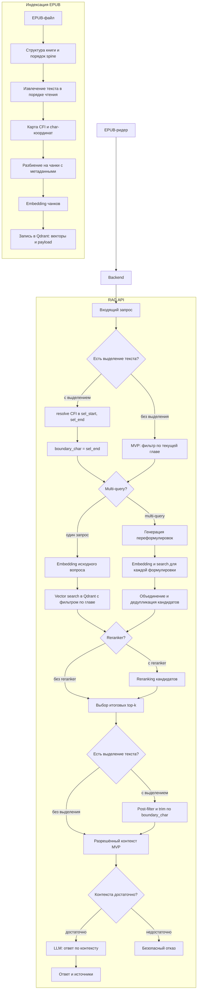

# ML System Design Doc – RAG по книгам с механизмом антиспойлера – MVP 1

## 1. Цели и предпосылки

### 1.1. Зачем идем в разработку продукта?

#### Бизнес-цель

Цель проекта – создать помощника для чтения, который позволяет задавать вопросы
по книге непосредственно во время чтения и получать ответы, основанные на её
тексте, без раскрытия ещё не прочитанных событий.

#### Текущее состояние продукта

В продукте уже работают:

- пользовательский интерфейс EPUB-ридера;
- бэкенд для работы с пользователями и книгами, включая сохранение прогресса
  чтения.

В текущей итерации эти компоненты не разрабатываются с нуля. Проект добавляет к
существующему продукту новую функцию: вопросы по книге на основе RAG с
антиспойлерным ограничением, использующим сохранённый прогресс чтения.

Продукт должен помочь читателю:

- уточнить смысл фрагмента, термина или события, не покидая книгу;
- вспомнить уже встречавшиеся факты и персонажей;
- получить краткое объяснение сложного места;
- избежать спойлеров из последующих частей книги.

#### Почему станет лучше, чем сейчас

Обычная языковая модель отвечает на основе знаний, полученных во время обучения,  
и не обязана опираться на текст конкретного издания. Поэтому она может смешать  
содержание книги с внешними сведениями, дать неточный ответ или ввести  
пользователя в заблуждение из-за галлюцинации. Кроме того, LLM может знать
события из ещё не прочитанной части книги и раскрыть их в ответе.

RAG ограничивает ответ содержимым конкретной книги, а механизм антиспойлера
дополнительно ограничивает доступный контекст текущим прогрессом чтения или
границей выделенного текста. Это снижает риск галлюцинаций и позволяет
формировать ответ, релевантный текущему месту чтения, без использования
последующих частей книги.

#### Что считаем успехом текущей итерации с точки зрения бизнеса

- пользователь может задать вопрос по добавленной книге;
- поддержаны вопросы с выделенным фрагментом и без выделения;
- пользователь получает ответ по разрешённой части книги вместе с источниками;
- пользовательская проверка не выявляет систематических спойлеров.

### 1.2. Бизнес-требования и ограничения

#### Бизнес-требования

1. Пользователь должен иметь возможность читать книгу и задавать вопросы по её

   содержанию.
2. Система должна поддерживать два режима:
   - **вопрос с выделением** – выделенный текст передаётся как явный контекст
    вопроса; retrieval не должен использовать текст после конца выделения;
   - **вопрос без выделения** – retrieval не должен использовать текст из глав,
    к которым пользователь ещё не приступил; уточнение границы внутри текущей
    главы – в следующих итерациях.
3. Ответ должен основываться на разрешённых фрагментах выбранной книги.
4. Если разрешённого контекста недостаточно, система должна сообщить об этом, а

   не дополнять ответ сведениями из непрочитанной части.
5. Для ответа нужно отображать использованные фрагменты книги, чтобы пользователь мог проверить источник.

#### Ограничения

- В первой итерации основной формат книги – EPUB.
- Антиспойлер ограничивает контекст по сохранённому прогрессу и выделению пользователя; динамический номер страницы не используется.
- Качество ответа ограничено качеством извлечения текста, embedding-модели,
retrieval и используемой LLM.
- В рамках MVP не гарантируется ответ на каждый вопрос: корректный отказ лучше
ответа без достаточного разрешённого контекста.

#### Ожидания от текущей итерации

- реализовать ingestion EPUB, чанкинг, embeddings и индексацию в Qdrant;
- реализовать и протестировать антиспойлерное ограничение по прогрессу и выделению пользователя;
- интегрировать RAG API с существующими ридером и бэкендом;
- сравнить четыре конфигурации RAG из раздела 2.1 и выбрать вариант для MVP;
- подготовить тесты качества retrieval и генерации;
- собирать трейсы запросов в Langfuse и измерять `p50`/`p95` latency.

#### Бизнес-процесс пилота

Пользователь открывает книгу в ридере, читает её и задаёт вопрос одним из двух
способов:

1. выделяет фрагмент и формулирует вопрос о нём;
2. задаёт общий вопрос с текущей позиции чтения.

Система определяет допустимую границу, извлекает только разрешённые фрагменты,
формирует ответ и показывает его вместе с источниками. После ответа пользователь
оценивает его полезность и наличие спойлера.

#### Предварительные критерии успешного пилота

- большинство вопросов, для которых в прочитанной части есть ответ, получают
  релевантный и подтверждённый источниками ответ;
- пользователи понимают ответ и не отмечают в нём раскрытие будущих событий.

### 1.3. Что входит в скоуп проекта/итерации, что не входит

#### Входит в скоуп

- обработка, чанкинг и индексация книг в формате EPUB;
- RAG для вопросов с выделенным фрагментом и без выделения;
- антиспойлерное ограничение по прогрессу чтения и выделению пользователя;
- сравнение четырёх конфигураций RAG из раздела 2.1;
- оценка качества retrieval, генерации и соблюдения антиспойлерного ограничения;
- трассировка RAG-пайплайна в Langfuse;
- воспроизводимый код, конфигурация Ruff и pre-commit, инструкция по запуску.

#### Не входит в скоуп

- разработка EPUB-ридера и пользовательского интерфейса чтения с нуля;
- разработка базового бэкенда пользователей, книг и хранения прогресса чтения;
- поддержка PDF, FB2 и других форматов;
- синхронизация прогресса между сторонними приложениями для чтения;
- поиск по нескольким книгам одновременно;
- рекомендательная система книг;
- обучение собственной LLM или embedding-модели;
- production-инфраструктура, высокая доступность и масштабирование на большое
число одновременных пользователей;
- полноценная система авторизации, оплаты и управления библиотекой;
- гарантированное устранение спойлеров, содержащихся в самом вопросе
пользователя.

#### Качество кода и воспроизводимость

- параметры ingestion и RAG должны задаваться конфигурацией;
- эксперимент должен фиксировать выбранные параметры и используемые модели;
- статический анализ и форматирование выполняются Ruff;
- проверки запускаются через pre-commit;
- README содержит команды установки, индексации и запуска;
- ключевая логика RAG и антиспойлера покрывается автоматическими тестами.

#### Планируемый технический долг

- первоначальная оценка качества может выполняться на небольшом вручную
размеченном наборе вопросов;
- более точное ограничение внутри текущей главы для вопросов без выделения
откладывается на следующую итерацию;
- production-мониторинг с алертами не входит в MVP; в пилоте используются
трейсы Langfuse;
- набор поддерживаемых EPUB может быть ограничен книгами без сложной вёрстки,
DRM и нестандартного порядка текста;
- защита от косвенного спойлера, который LLM восстановила из общих знаний, может
потребовать дополнительных guardrails.

### 1.4. Предпосылки решения

Существующие ридер и бэкенд хранят прогресс пользователя по каждой книге. Для
RAG используются текущая глава и CFI-позиция пользователя.

**CFI (EPUB Canonical Fragment Identifier)** – адрес конкретного места внутри
EPUB, который не зависит от размера экрана или шрифта.

На бэкенде CFI преобразуется в **char-координату** – порядковый номер символа в
извлечённом тексте книги. CFI начала и конца выделения преобразуются в
`char_start` и `char_end`.

Антиспойлер ограничивает поиск текущей главой и границей выделения, чтобы текст
из непрочитанной части книги не передавался в LLM. Для каждой книги используется
отдельная коллекция Qdrant.

## 2. Методология `Data Scientist`

### 2.1. Постановка задачи

С технической точки зрения разрабатывается RAG-система вопрос-ответ по книге,
которая учитывает сохранённый прогресс чтения пользователя.

Задача состоит из следующих частей:

1. извлечь текст EPUB, разбить его на чанки и проиндексировать в Qdrant;
2. найти релевантные фрагменты с учётом прогресса чтения и выделения;
3. сформировать ответ по найденному контексту и вернуть источники либо

   корректный отказ;
4. сравнить конфигурации RAG по качеству, скорости и стоимости.

#### Бейзлайн

- фиксированный размер чанка и overlap;
- vanilla dense retrieval: один embedding исходного вопроса;
- `top-k` релевантных фрагментов из коллекции книги;
- генерация ответа по найденному контексту.

#### Сравниваемые конфигурации RAG

1. **Vanilla RAG без реранкинга.** Для исходного вопроса строится один

   embedding, после чего из Qdrant извлекаются `top-k` наиболее похожих
     разрешённых чанков.
2. **Vanilla RAG с реранкингом.** Сначала dense retrieval извлекает расширенный

   набор кандидатов, затем reranker повторно оценивает пары
     «вопрос – чанк» и выбирает итоговые `top-k` чанков.
3. **Multi-query RAG без реранкинга.** LLM формирует несколько переформулировок

   исходного вопроса. Для каждой формулировки выполняется dense retrieval,
     результаты объединяются, дублирующиеся чанки удаляются, после чего
     выбираются итоговые `top-k` кандидатов.
4. **Multi-query RAG с реранкингом.** Кандидаты, полученные по исходному вопросу

   и его переформулировкам, объединяются и передаются reranker, который выбирает
     итоговые `top-k` чанков.

Для корректного сравнения на первом эксперименте фиксируются embedding-модель,
параметры чанкинга, антиспойлерный фильтр и итоговое количество чанков,
передаваемых в LLM. Конфигурации сравниваются на одном наборе вопросов по
качеству retrieval и ответа, задержке и стоимости. Настройка размера чанка,
overlap и `top-k` выполняется отдельно, чтобы не смешивать влияние нескольких
факторов.

### 2.2. Блок-схема решения

Схема отражает **двухэтапный антиспойлер**: фильтр по главе в Qdrant и
post-filter по `boundary_char` после retrieval (при выделении); resolve CFI на
бэкенде по той же карте, что при индексации.

### 2.3. Этапы решения задачи

#### Этап 1. Подготовка данных

Обучение собственной модели не планируется. Для индексации и оценки RAG
используются следующие данные:

| Название данных | Есть ли данные и источник | Требуемый ресурс для получения данных | Проверено ли качество |
|---|---|---|---|
| Книги в формате EPUB | Да, существующее хранилище книг | Backend-разработчик, Data Scientist | Нет, требуется проверить извлечение текста на разных EPUB |
| Прогресс чтения и CFI-позиции | Да, существующий бэкенд | Frontend-разработчик, Backend-разработчик, Data Scientist | Частично, хранение прогресса уже работает |
| Вопросы, релевантные фрагменты и эталонные ответы | Нет, будут подготовлены для проекта | Data Scientist, ручная разметка | Нет |

- извлечь текст EPUB, разбить его на чанки и проиндексировать в Qdrant;
- проверить корректность индексации на книгах с разной структурой.

#### Этап 2. Бейзлайн RAG

- реализовать vanilla dense retrieval и генерацию ответа;
- подготовить контрольный набор вопросов и измерить качество бейзлайна.

#### Этап 3. Механизм антиспойлера

- ограничить контекст прогрессом чтения и выделением пользователя;
- проверить механизм на контрольном наборе.

#### Этап 4. Эксперименты с RAG

- сравнить четыре конфигурации из раздела 2.1 на одном наборе вопросов;
- выбрать вариант для MVP по качеству, задержке и стоимости.

#### Этап 5. Подготовка пилота

- интегрировать RAG API с существующими интерфейсом чтения и бэкендом;
- добавить отображение источников и сбор пользовательской оценки.

## 3. Подготовка пилота

### 3.1. Способ оценки пилота

Пилот проводится на подготовленном наборе книг, пользовательских вопросов и
зафиксированных позиций чтения. Для части вопросов дополнительно задаются
выделенный фрагмент и эталонные фрагменты, содержащие ответ.

В пилоте используется конфигурация RAG, выбранная по результатам этапа 4.

Для выбранной конфигурации измеряются retrieval-метрики, качество ответа, время
отклика (`p50` и `p95` latency) и примерная стоимость запроса. Антиспойлерное
ограничение проверяется отдельно и не участвует в компромиссе между качеством и
скоростью.

После автоматической оценки проводится пользовательская проверка. Пользователь
читает книгу, задаёт вопросы с выделением и без него, оценивает полезность
ответа и отмечает возможный спойлер или утверждение, не подтверждённое книгой.

### 3.2. Что считаем успешным пилотом? Критерии успеха

- `Recall@10 ≥ 0.80` – найдено не менее 80% релевантных фрагментов;
- `Hit@10 ≥ 0.90` – хотя бы один релевантный фрагмент найден для 90% вопросов;
- `MRR@10 ≥ 0.60` – первый релевантный фрагмент находится достаточно высоко в
выдаче;
- `Faithfulness ≥ 0.90` – утверждения ответа подтверждаются контекстом;
- `Answer Correctness ≥ 0.75` – ответ соответствует эталонному ответу;
- `Anti-spoiler Rate < 5%` – доля запросов, в которых в контекст LLM попал текст
  после разрешённой границы, составляет менее 5%;
- система возвращает источники, которыми подтверждается ответ;
- пользовательская проверка не выявляет систематических спойлеров и
неподтверждённых ответов.

### 3.3. Подготовка пилота

До запуска пилота необходимо:

- выбрать набор EPUB с разной структурой и проверить работу `extract_v1`;
- подготовить вопросы разных типов и эталонные фрагменты;
- зафиксировать позиции прогресса и выделения для антиспойлерных тестов;
- подготовить контур оценки выбранной конфигурации RAG;
- оценить число обращений к embedding-модели, reranker и LLM;
- установить ограничения на число multi-query-переформулировок, число
retrieval-кандидатов и итоговый `top-k`;
- добавить трейсы Langfuse: один trace на пользовательский запрос и spans для
multi-query, embedding, retrieval, reranking, post-filter и LLM;
- сохранять в trace конфигурацию RAG, времена этапов, токены и стоимость,
идентификаторы найденных чанков, scores и результат антиспойлерного фильтра;
- добавить сбор использованных источников и пользовательской оценки.

Ожидаемые вычислительные затраты уточняются на экспериментах. Multi-query
увеличивает число retrieval-запросов и требует вызова LLM для генерации
переформулировок, а reranking добавляет отдельную обработку набора кандидатов.
Поэтому финальная конфигурация выбирается не только по качеству, но и по
задержке и стоимости.

#### Открытые вопросы и риски перед пилотом

- Как версионировать и тестировать карту соответствия CFI и char
(UTF-16 vs code points)?
- Какая embedding-модель, reranker и LLM будут доступны по ограничениям
стоимости?
- Как оценивать непрямой спойлер, который модель знает из предобучения, даже
если запрещённый текст не передан в prompt?
- Как обрабатывать сноски, иллюстрации, скрытые элементы и сложную вёрстку EPUB?

## 4. Внедрение `для production систем, если требуется`

Production-внедрение не входит в текущую итерацию. Ниже зафиксировано состояние
каждого пункта из шаблона. Детальные решения будут описаны после выбора
конфигурации RAG и завершения пилота.

### 4.1. Архитектура решения

Архитектура существующих ридера и бэкенда не изменяется. В MVP к ним
подключается RAG-пайплайн: получение CFI и текущей главы, `resolve`, retrieval в
коллекции Qdrant книги, двухэтапный антиспойлер и вызов LLM.

### 4.2. Описание инфраструктуры и масштабируемости

Выбор облачной платформы, способа развёртывания и горизонтального
масштабирования откладывается до получения результатов пилота и оценки нагрузки.

### 4.3. Требования к работе системы

Production SLA и пропускная способность пока не определены. В экспериментах
измеряются end-to-end `p50` и `p95` latency каждой конфигурации RAG.

### 4.4. Безопасность системы

Детальная модель угроз не входит в текущую итерацию. Перед production-запуском
потребуется предусмотреть проверку загружаемых EPUB, защиту API, изоляцию
пользовательских данных и защиту RAG-пайплайна от prompt injection в тексте
книги.

### 4.5. Безопасность данных

Для книг и прогресса чтения используются существующие правила хранения.
Дополнительно необходимо определить правила хранения истории вопросов, ответов
и трасс RAG. До production-запуска должны быть проверены лицензионные
ограничения на обработку книг и требования применимого законодательства о
персональных данных.

### 4.6. Издержки

Расчёт месячных издержек будет выполнен после измерения числа вызовов
embedding-модели, reranker и LLM. Особое внимание требуется multi-query RAG,
так как он добавляет генерацию переформулировок и несколько retrieval-запросов.

### 4.7. Integration points

Точки интеграции новой функции – существующие EPUB-ридер и бэкенд,  
Qdrant, сервис embedding-модели, reranker, LLM и Langfuse для трассировки.  
Контракты между существующим бэкендом и RAG API должны быть зафиксированы в  
MVP. Из-за приватности и авторских прав полный текст книги и фрагменты prompt не должны сохраняться в Langfuse по умолчанию; достаточно идентификаторов чанков, метаданных и агрегированных  
метрик.

### 4.8. Риски

- сложная вёрстка EPUB может нарушить соответствие между DOM/CFI и глобальным
offset;
- LLM может использовать собственные знания и сформировать непрямой спойлер,
даже если запрещённый текст не передавался в prompt;
- multi-query и reranking могут улучшить качество недостаточно, чтобы оправдать
увеличение задержки и стоимости;
- хранение пользовательских книг может быть ограничено авторскими правами и
условиями распространения конкретного издания.
